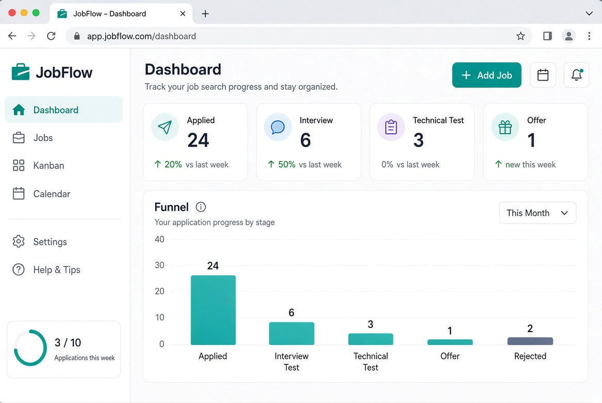
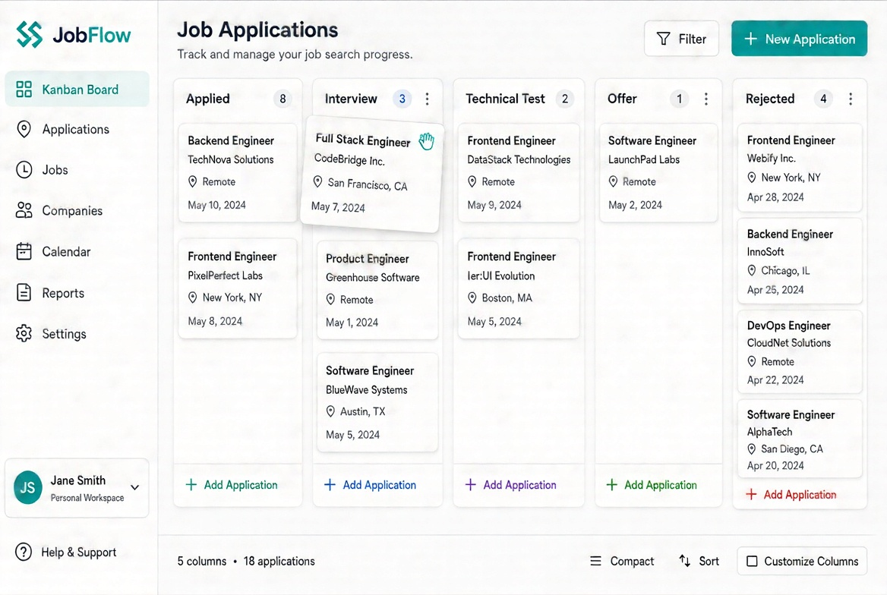
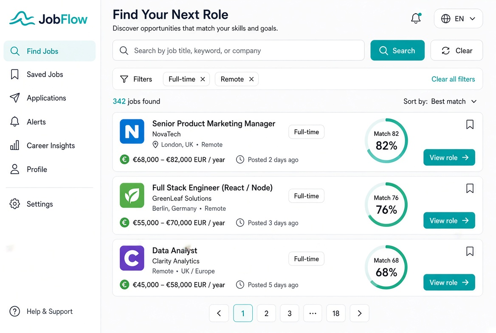

# JobFlow

English job-search workspace for profiles, applications, interviews, and CVs.

Demo account: `demo` / `DemoPass123!`

## Screenshots







These previews show the dashboard, drag-and-drop board, and job search. The running app uses the same English labels and flows.

## Run locally

```bash
cp .env.example .env
docker compose up --build
```

- App: http://localhost:3000
- API: http://localhost:8000/api/v1/
- Swagger: http://localhost:8000/api/v1/docs/
- Health: http://localhost:8000/api/v1/auth/health/
- Metrics: http://localhost:8000/api/v1/auth/metrics/

`.env` is not committed. Copy `.env.example`.

## Production deploy

On a VPS with Docker:

```bash
export DJANGO_SECRET_KEY="$(openssl rand -hex 32)"
export POSTGRES_PASSWORD="$(openssl rand -hex 16)"
export FRONTEND_URL="https://your-domain.example"
export SECURE_SSL_REDIRECT=0
docker compose -f docker-compose.prod.yml up --build -d
```

Nginx listens on port 80, adds security headers, and proxies `/api/` plus `/health` to Django. Put Caddy or Certbot in front for TLS, then set `SECURE_SSL_REDIRECT=1`. Production refuses a short or default `DJANGO_SECRET_KEY`. Cookies are HttpOnly and Secure when debug is off. The API container runs as a non-root user and exposes a health check.

## What is included

- Drag-and-drop kanban across Applied, Interview, Technical Test, Offer, and Rejected
- CI for Django tests, PostgreSQL migrate/seed, TypeScript, and Playwright
- Playwright coverage for landing, login, register, password reset, and kanban drag
- Match score with skill synonyms, title, location, and requirement coverage
- Analytics for funnel, weekly volume, company mix, interview rate, offer rate, and win rate
- Health check and plain-text metrics for uptime, database, cache, jobs, and applications
- JWT cookies, email verification, password reset, rate limits, and owner-scoped records

Architecture: `docs/ARCHITECTURE.md`
