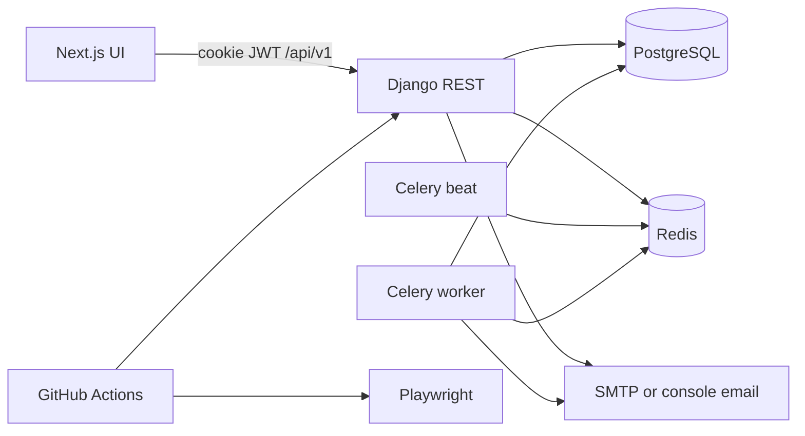

# JobFlow architecture

Browser calls same-origin `/api/v1`, which Next.js rewrites to Django. Access and refresh tokens are HttpOnly cookies. Celery sends deadline emails. Swagger lives at `/api/v1/docs/`.
